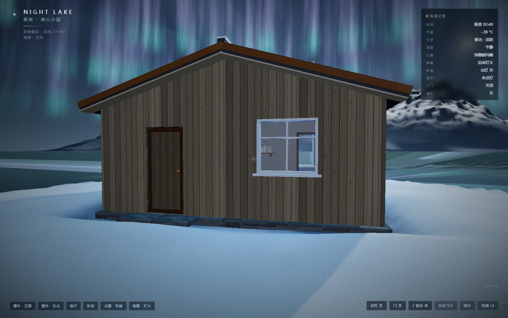
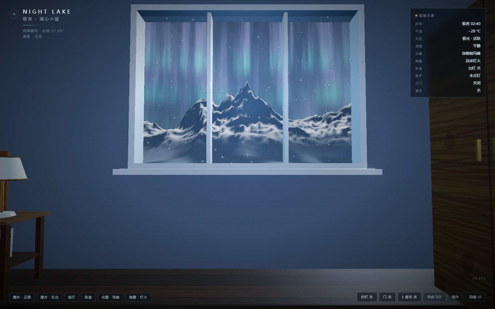

# Night Lake · 极夜 · 湖心小屋

一座建在极夜大湖中央小岛上的北欧风格小屋。北面窗框着珠穆朗玛峰，南面大门旁
的窗户望得见远处岸上的灯火。可以第一人称自由探索屋内屋外，门能开关，卧室台灯
能开关，音乐能开关。

打开 `index.html` 即可（需要通过 HTTP 访问，不能用 `file://`）。

**在线预览**：<https://zer0zn.github.io/night-lake/>




## 本地运行

```bash
python -m http.server 8099 --bind 0.0.0.0
# 然后打开 http://127.0.0.1:8099/
```

## 构建

```bash
node build.mjs          # 产出 dist/app.js
node build.mjs --watch  # 开发模式，不压缩
```

`dist/app.js` 是唯一产物，`index.html` 直接引用它。没有运行时依赖 CDN。

## 操作

| 按键 | 作用 |
| --- | --- |
| `W A S D` / 方向键 | 移动 |
| `Shift` | 快走 |
| 鼠标拖动 / 点击锁定 | 转头 |
| `Space` / 左键 | 与门、台灯交互（准星对准时提示） |
| `L` | 开关卧室台灯 |
| `M` | 开关音乐 |
| `F` | 自由飞行 |
| `H` | 帮助面板 |
| `Q` / `E` | 切换视角预设 |
| `1`–`6` | 直接跳转到某个视角 |

界面上也有对应的按钮和 6 个视角切换 chip。

## 场景构成

- **小岛**：程序生成的地形穹丘，雪线、岩石只在浪蚀边缘出现；`terrainHeight()` 在
  屋子占位区被压平成平台。
- **小屋**：木构架 + 竖板外墙，真实开洞的墙体（`ExtrudeGeometry` 带 holes），
  双坡屋顶带椽、屋面板、檐底板和檐沟；室内铺松木地板、吊顶带外露椽子和系梁。
- **室内**：客厅有冰箱、餐桌、椅子、长凳、书架、地毯；卧室有双人床（网格布料
  悬垂出的被子与枕头）、床头柜、衣柜、可开关的暖色台灯。客厅刻意不点灯，只有
  北窗/南窗的冷色溢光，符合「室内冷色调、只有卧室有台灯」的要求。
- **珠穆朗玛峰**：位移高度场 `buildRange()`，程序化山脊、沟壑、按坡度烘焙的积雪、
  烘死的月光方向和大气透视。整片山是 `MeshBasicMaterial + vertexColors`（纯烘焙），
  不参与实时光照，因此远山上不会出现锯齿状的阴影。
- **远岸村庄**：暗色岸线楔形体 + 针叶林 + 64 栋房屋（每栋 4 扇暖色窗） + 岸边离散
  光点，作为「远处岸上的灯火」。
- **天空**：着色器天空球，极夜渐变、哈希星场、银河带、三层极光帘幕、
  带光晕的凸月、地平线雾。
- **湖面**：自定义 `Reflector` 着色器，反射 UV 被低频涌浪扰动，菲涅耳 + RGB 拖影 +
  距离雾，平静无波。
- **雨滴**：北窗玻璃上的水珠是贴图（珠体 + 亮边 + 高光），另有会走走停停的流痕。
  早期版本用小球体做雨滴，结果读成了雪；水体必须用带亮边和高光的贴图来画。

## 参数

屋子的尺寸、开洞、家具位置都在 `src/house.js` 顶部的 `H` 常量里。局部坐标
`+Z` 朝南、`-Z` 朝北（对应珠峰方向）。改完记得同步 `houseViewpoints()` 里的机位。

## 音乐

代码**不附带**受版权保护的《the rescue》(Antent / Nectry) 音轨。`src/audio.js` 会先
探测 `assets/the-rescue.{mp3,ogg,m4a,wav}`，文件存在（>1KB）就播放；否则回退到一段
同调的纯程序化配乐（风噪铺底 + A 小调加九和弦长音 + 卷积混响 + 稀疏的毡锤钢琴音）。

要听原曲，把你自己合法获得的音频放到 `assets/the-rescue.mp3` 即可，无需改代码。

## 目录

```
index.html       UI + HUD
build.mjs        esbuild 打包
src/main.js      渲染器、后期、交互、视角
src/stage.js     天空、湖面、小岛、山脉、村庄、灯光
src/house.js     小屋与全部家具、门窗、室内灯
src/player.js    第一人称控制器与碰撞
src/audio.js     音乐（文件优先，程序化兜底）
src/materials.js 全部材质与程序化贴图
src/util.js      几何与噪声工具
tools/shot.py    Playwright 截图/探针脚本
```

## 性能

`?q=low` 会把反射贴图、阴影贴图和辉光降到低档，并关闭抗锯齿，适合集显。
默认档在 1600×1000 下约 450 个 mesh / 16.4 万三角面。
